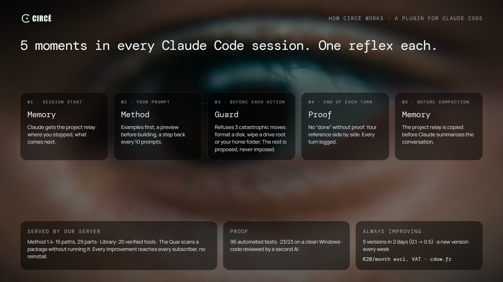

### I'm Cleo. I build CIRCÉ, a living system for Claude Code.

CIRCÉ is a Claude Code plugin that plugs into 5 moments of every session, with one reflex each.

- **Memory.** At session start, Claude gets the project relay: where you stopped and what comes next. The relay is copied before the conversation is compacted.
- **Method.** Examples first, a preview before building, and a step back every 10 prompts. 15 paths are served by our server, so they are always up to date.
- **Guard.** Only 3 catastrophic moves are refused: formatting a disk, wiping a drive root, wiping your home folder. Everything else is proposed, never imposed.
- **Proof.** No "done" without proof.
- **Library.** 20 verified tools, plus the Quai, which reads a package's code without ever running it.

€20/month excl. VAT · full refund within 14 days · [cdow.fr/en](https://cdow.fr/en/)

Docs, changelog and support: [cleobaud/circe](https://github.com/cleobaud/circe)

---

**En français.** Je crée CIRCÉ, un système vivant pour Claude Code, inspiré des mécanismes du corps : [cdow.fr](https://cdow.fr).

Les créations (sites, vidéos, 3D) se font sur devis : contact@cdow.fr
